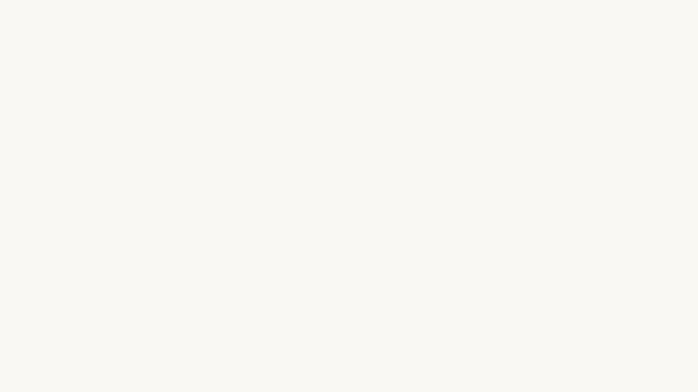
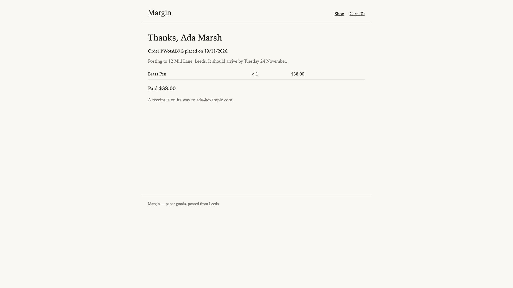

# Upkeep

**Updates your outdated packages and proves in a real browser that the app still works.**

Built at the KaneCLI Online Hackathon (TestMu AI), 12–26 November 2026. Coding agent: Claude Code.
Verifier: [Kane CLI](https://github.com/LambdaTest/kane-cli).

**Proof.** A shop app pinned to packages released between 2018 and 2022 was 12 packages behind
(React 17, Vite 4, react-hook-form 6, date-fns 1). One command, 33 minutes, no person involved:

- **12 of 12 upgraded**, to React 19, Vite 8 and the rest, on a branch of six commits.
- **4 upgrades broke the app.** `nanoid` 6 failed the build. `date-fns` 4, `js-cookie` 3 and
  React 19 (with its form and markdown libraries) built fine and failed only in the browser,
  where Kane CLI found a blank page each time.
- **Claude Code fixed all 4, each in one round**: three from Kane's failure record, one from the
  build error.
- **Kane CLI passed 3 of 3 flows before every commit.** 29 checks, 408 Kane credits.

The whole run is in [`evidence/2026-11-19-2222-all-twelve-rerun/`](evidence/2026-11-19-2222-all-twelve-rerun/report.md):
the report, every check, and what Upkeep sent the agent and got back. It was made by Upkeep at
commit `ec96636` with Kane CLI 0.10.6. An earlier run of the same upgrade on older code is in
[`evidence/2026-11-19-2110-all-twelve/`](evidence/2026-11-19-2110-all-twelve/report.md)
(27 checks, 557 credits).

| `date-fns` 1 → 4: what Kane saw after the upgrade | What Kane saw after the agent's fix |
|---|---|
|  |  |
| `npm run build` passed. The order page is blank. | "Thanks, Ada Marsh. Order placed on 19/11/2026." |

Both screenshots are Kane CLI's own, taken from its evidence packs.

## The problem

Dependabot and Renovate open the pull request and trust your CI. But the upgrades that hurt build
fine and pass type checks. `date-fns` 2 renamed its format tokens, so `format(date, 'DD/MM/YYYY')`
still compiles and throws when the page renders. Nothing in a normal pipeline opens the order
page. So upgrade pull requests pile up unmerged, or get merged on faith.

Coding agents make this worse in a new way: an agent bumps twelve packages and says "done",
having opened nothing.

## How it works

```
npm outdated ──► plan ──► worktree on a new branch
                              │
              ┌───────────────▼────────────────┐
              │ apply a set of upgrades         │
              │ install → build → boot → Kane   │◄─────────────┐
              └───────┬───────────────┬─────────┘              │
                   pass             fail                       │
                      │               │                        │
                 commit it     narrow it to a set that         │
                               fails the same way              │
                                      │                        │
                               confirm with a full Kane check  │
                                      │                        │
                               Kane's failure ──► coding agent edits the app
                                                  (flows and versions are off limits)
```

1. **Plan** (`src/plan/`). Reads `npm outdated`, labels each jump as compatible or may-break, and
   groups upgrades that need each other. `react-markdown` 10 needs React 18, so it travels with
   React. The reasons are printed.
2. **Work somewhere else** (`src/workspace/worktree.mjs`). A git worktree on a new branch,
   outside the repository. Your checkout is not touched.
3. **Check** (`src/check/staged-check.mjs`). Install, build, boot the app, then Kane CLI walks
   your plain-English flows. Cheapest first: an upgrade that does not build costs no credits.
4. **Land what passes.** One commit per verified set, with the Kane result in the message.
5. **Isolate what fails** (`src/isolate/ddmin.mjs`). Delta debugging over the upgrades narrows a
   failing set until taking out any one upgrade makes it pass. One culprit among n takes about
   2·log₂(n) checks, and it finds pairs that only break together. Upgrades that passed on their
   own during the search land first, and the rest is checked again on top of them.
6. **Fix it with the agent** (`src/agent/`). The agent gets Kane's own words: the failing step,
   the console error, Kane's root cause and screenshot (or the build error, when the upgrade
   fails before the browser). It edits the app. Kane walks the app again. A new failure opens the
   next round; a pass lands the upgrade with the fix.
7. **Report** (`src/report/`). What landed, what needed a fix, what was held back and why, and
   every check with its time and credits. `--pr` opens it as a pull request.

## For judges: verify in two minutes

Nothing below needs a Kane account or an install. Node 20 or newer.

| Do this | You see |
|---|---|
| Open [`evidence/2026-11-19-2222-all-twelve-rerun/report.md`](evidence/2026-11-19-2222-all-twelve-rerun/report.md) | The full run: 12 packages, the 4 that broke the app with Kane's words and the agent's fix, and all 29 checks with time and credits |
| Open [`agent/js-cookie/round-1-task.md`](evidence/2026-11-19-2222-all-twelve-rerun/agent/js-cookie/round-1-task.md) in the same folder | Exactly what Kane's result looked like when it reached the agent |
| Download [`report.html`](evidence/2026-11-19-2222-all-twelve-rerun/report.html) and open it | The same report as one offline page, with Kane's before and after screenshots |
| `node tools/check-claims.mjs` | PASS or FAIL for every claim in the table below, and for the rules in the published ledgers |
| `npm test` | Every test passes, with no install step |
| `node bin/upkeep.mjs plan --cwd /path/to/any/npm/project` | The plan for your own project: what is behind, what may break, what moves together and why |

With a Kane account (`kane-cli login --oauth`) and Claude Code installed, see [Run it](#run-it).

## The three bars

| Bar (quoted from the event page) | Where |
|---|---|
| "It works end to end." | Real runs in [`evidence/`](evidence/), each plan → worktree → install → build → boot → Kane → commit on a branch. Two of them upgrade all 12 packages of the demo shop. |
| "Kane CLI caught or proved something." | Caught: three upgrades that build fine and leave a blank page (`date-fns` 4, `js-cookie` 3, React 19 with its form and markdown libraries). Proved: every one of the six commits, 3 of 3 flows each. |
| "Your agent and Kane CLI talked to each other." | Kane's failure record is the agent's task (three of the four in [`agent/`](evidence/2026-11-19-2222-all-twelve-rerun/agent/); the fourth is a build error); the agent's edit is judged by Kane's next walk (`src/agent/fix-loop.mjs`). No person in between. |

## Judging criteria

| Criterion (quoted) | Where Upkeep meets it |
|---|---|
| **Ships.** "A real flow that runs end to end. Not slides." | `upkeep run` produced the branches and commits recorded in `evidence/*/ledger.ndjson`: an app on 2018–2022 packages moved to React 19 and Vite 8 in one command. |
| **Verified.** "Kane CLI caught or confirmed something meaningful." | Breaks from real upstream releases, not planted bugs: the shop is ordinary code written against old versions. Three times the build and bundler said yes and Kane said no. |
| **Closed loop.** "Kane's result feeds back to the agent. Tighter is better." | Kane's verdict decides three things with no person involved: which set of upgrades to try next (the search), what the agent is told, and whether the result is committed or thrown away. |
| **Craft.** "Would a developer want to install this tonight?" | No dependencies, no config for Vite, Next and Astro, a credit budget, quick checks while searching, a guard against an agent that edits the tests, a report you can paste into a pull request. |

## Sponsor integration: what Kane CLI does here

Kane is the only judge. Upkeep never looks at the page itself.

- **`kane-cli testrun run … --agent --headless`** runs the flows as one suite (`src/kane/run-suite.mjs`).
  Recorded steps replay, which is what makes a search affordable: three passing flows in about
  50 to 65 seconds for 6 to 9 credits.
- **Heal, on and off.** A full check lets Kane heal a step that no longer matches the page before
  calling it a failure. A quick check (`--no-adaptive-heal`) stops at the first mismatch. Upkeep
  searches with quick checks and confirms with a full one, so a harmless change in the page is
  never blamed (`src/loop/land-upgrades.mjs`).
- **Recordings only move forward on a pass.** A failing check changes the recorded steps (the
  ledger marks each time it happened), and the next check would pay to write them again. Upkeep
  copies them before each check and puts them back after any check that does not pass. On the
  same fix this took the verifying check from 91 credits to 8 (`keepRecordings` in
  `src/run/upgrade-run.mjs`).
- **The NDJSON stream** is read per flow, because Kane exits 1 both when a flow fails and when a
  flow could not run. Only the first says anything about an upgrade (`src/kane/read-suite-stream.mjs`).
- **Evidence packs** are opened for the failing step, Kane's triage (root cause, suggested fix),
  the browser console and the screenshot (`src/kane/read-evidence.mjs`). These go to the agent
  and into the report.
- **Policies and verdicts.** After each check the pack is judged with
  `kane-cli evidence verdict --policy` on two of Kane's own metrics. `metrics.tests_without_checks`:
  a flow that verifies nothing passes whatever the app does, so Upkeep refuses to start from one.
  `metrics.heal.healed_tests`: Kane healed a step, so the page changed and the flow still passed;
  the report says so (`src/kane/judge-pack.mjs`).
- **`kane-cli balance`** before and after each check gives the credits it used, for the report
  and the `--budget` cap.

What was found in Kane CLI while building this is written up for its team in
[`FEEDBACK.md`](FEEDBACK.md).

## Claims

Every claim made here, the line of code behind it, and how it is checked.
`node tools/check-claims.mjs` checks that each row points at the code it names and that this
table is exactly the one `tools/claims.json` generates. Whether the code does what a row says is
what the test named in that row checks; `npm test` runs them all.

<!-- claims:start -->
| Claim | Where in code | Checked by |
|---|---|---|
| Plans upgrades from `npm outdated`, keeps each range style, labels a jump breaking by the caret rule | `src/plan/outdated.mjs:40` | `test/outdated.test.mjs` |
| Moves upgrades that need each other as one unit, from the peer ranges of installed and target versions | `src/plan/peer-links.mjs:28` | `test/peer-links.test.mjs`; `upkeep plan` prints each reason |
| Narrows a failing set of upgrades by delta debugging until taking out any one makes it pass, including pairs that only break together | `src/isolate/ddmin.mjs:20` | `test/ddmin.test.mjs` |
| Every check is install, then build, then boot, then Kane CLI; it stops at the first failure so a broken build costs no credits | `src/check/staged-check.mjs:59` | `test/staged-check.test.mjs` |
| Runs the flows with `kane-cli testrun run --agent --headless` | `src/kane/run-suite.mjs:45` | `test/run-suite.test.mjs`; every check in `evidence/*/ledger.ndjson` |
| A flow Kane could not run (runner crash, no browser) is never read as a broken app, even though Kane exits 1 for both | `src/kane/read-suite-stream.mjs:122` | `test/read-suite-stream.test.mjs`, against a real capture of a runner crash |
| Refuses to start from flows that verify nothing, and reports steps Kane healed, using Kane's own policy engine (`kane-cli evidence verdict --policy`) | `src/kane/judge-pack.mjs:66` | `test/judge-pack.test.mjs`, `test/upgrade-run.test.mjs` |
| The search uses quick checks (no heal); nothing is blamed, handed to the agent or held back without a full check | `src/loop/land-upgrades.mjs:134` | `test/land-upgrades.test.mjs`; `node tools/check-claims.mjs` checks it in the published ledgers |
| Nothing is committed unless a check passed on exactly that set of upgrades | `src/loop/land-upgrades.mjs:88` | `node tools/check-claims.mjs` checks every landed set in `evidence/*/ledger.ndjson` |
| Kane's failure goes to the agent as Kane wrote it: its message, the failing step, console errors, its own root cause | `src/agent/failure-packet.mjs:87` | `evidence/2026-11-19-2222-all-twelve-rerun/agent/js-cookie/round-1-task.md` |
| Reads the failing step, Kane's triage, the console and the screenshot out of the evidence pack | `src/kane/read-evidence.mjs:107` | `test/read-evidence.test.mjs` |
| After the agent edits the app, Kane walks it again; a new failure opens the next round | `src/agent/fix-loop.mjs:95` | `test/fix-loop.test.mjs`; `evidence/2026-11-19-2222-all-twelve-rerun/report.md` |
| An agent already in a session can be the fixer: the run pauses with Kane's failure, `upkeep wait` prints it, `upkeep continue` sends the edit back to Kane | `src/agent/handoff.mjs:54` | `test/handoff.test.mjs` |
| `upkeep mcp` serves the same loop as tools over the Model Context Protocol, with no dependencies | `src/mcp/server.mjs:142` | `test/mcp-server.test.mjs`, including a real server process on stdio |
| An agent that edits the flows, the recordings or the versions instead of the app has that undone | `src/agent/guard-patch.mjs:133` | `test/guard-patch.test.mjs` |
| Works in a git worktree outside the repository; the checkout is not touched | `src/workspace/worktree.mjs:62` | `test/worktree.test.mjs` |
| Needs no configuration for Vite, Next and Astro projects: the address comes from the flows | `src/config/resolve-config.mjs:79` | `test/resolve-config.test.mjs` |
| Published evidence carries no account details: packs are left out, emails and home paths removed | `src/report/export-run.mjs:77` | `test/export-run.test.mjs`; `node tools/check-claims.mjs` scans `evidence/` |
| No dependencies | `package.json:30` | `package.json` has no `dependencies`; `node tools/check-claims.mjs` |
| `--budget` stops new checks once the credits are spent; what landed stays on the branch | `src/run/upgrade-run.mjs:265` | `test/upgrade-run.test.mjs` |
<!-- claims:end -->

## What is real, and what is a stand-in

| Part | Status | Where to look |
|---|---|---|
| Kane verdicts in `evidence/` | Real runs, Kane CLI 0.10.6, 19 November 2026 | `evidence/*/ledger.ndjson` has each check's flows, seconds and credits |
| The agent's fixes | Real: Claude Code, headless, one round each | `evidence/2026-11-19-2222-all-twelve-rerun/agent/` holds each task and reply |
| The app being upgraded | A demo shop written for this project against packages released 2018–2022. Nothing in it is a planted bug; what breaks is what the new releases changed | `evidence/*/run.json` lists the packages and versions |
| Unit tests of the loop, the fix loop and the check | Use stand-ins for Kane and for the agent, and say so at the top of each file | `test/land-upgrades.test.mjs`, `test/fix-loop.test.mjs`, `test/staged-check.test.mjs` |
| Tests of `upkeep run` as a whole | A real git repository, worktree, commits, ledger and report. The plan, the check and the Kane account are stand-ins | `test/upgrade-run.test.mjs` |
| Tests of the Kane runner | Go through a real child process against a stub binary | `test/stubs/kane-cli-stub.mjs` |
| The stream reader | Tested against a real capture, including a runner crash | `test/fixtures/kane-suite-authored-one-broken.ndjson` |
| The "flow verifies nothing" stop | Fired on a real run: a flow with no verify step was given to Kane, Kane passed it, Kane's policy metric counted it, and Upkeep stopped before any upgrade | [`evidence/2026-11-19-2157-flow-without-checks/`](evidence/2026-11-19-2157-flow-without-checks/ledger.ndjson), `test/upgrade-run.test.mjs` |
| Handoff mode (`--agent handoff`, `upkeep wait`, `upkeep continue`) | Used on a real run: the fixer was the Claude Code session that built Upkeep, taking the task from `upkeep wait` and answering with `upkeep continue` | [`evidence/2026-11-19-2147-handoff-and-guard/`](evidence/2026-11-19-2147-handoff-and-guard/report.md), `test/handoff.test.mjs` |
| The guard on a real run | In that same run the agent **deliberately** weakened `flows/checkout_test.md` along with the real fix, to see the guard work. Upkeep undid the flow edit, kept the fix, and Kane passed. It was a probe by us, not something an agent did unprompted | the "Undone by Upkeep" line in that run's report |
| The MCP server (`upkeep mcp`) | Tested by speaking JSON-RPC to the real server process. **Not yet connected to a real MCP client** | `test/mcp-server.test.mjs` |
| The Codex CLI preset (`--agent codex`) | Written from the Codex documentation. **Not run by us**: Codex is not installed here | `src/agent/ask-agent.mjs` |

## Not built yet

- A run on someone else's open-source app. All five published runs are on the demo shop.
- Package managers other than npm. pnpm, Yarn and Bun projects are not supported.
- Monorepo workspaces as a whole. A single package in a subfolder works; upgrading across
  workspaces does not.
- Resuming a run that was interrupted. A new run starts again from your last commit.
- Mobile flows. Kane CLI can drive simulators; Upkeep only serves web apps.

## Trust model and limits

- **The flows are the definition of "works".** Upkeep proves the app still passes your flows. It
  says nothing about behaviour no flow covers. Three flows covering sign-in, the main journey and
  payment catch far more than none, and far less than everything.
- **The agent runs with your permissions**, in a worktree of your repository. Claude Code is
  started with file tools only and no shell. The guard (`src/agent/guard-patch.mjs`) undoes edits
  to the flows, their recordings and the versions. It is a guard against a lazy fix, not a
  security boundary.
- **Installing a new release runs its code.** `npm install` runs the install scripts of every
  new version, as it would for any upgrade you make by hand. Upkeep does not pass
  `--ignore-scripts`, because many packages need them to build. Read `upkeep plan` first.
- **Nothing is pushed** unless you pass `--pr`. Upkeep holds no token; it uses your `git` and `gh`.
- **Kane credits are spent.** Measured on the demo shop with three flows: 6 to 9 per passing
  check, 17 to 25 for a quick failing one, 50 to 85 for a full failing one in which Kane tries to
  heal every flow. A check that fails at install or build costs nothing. The latest run of all
  12 packages used 408. `--budget` caps a run.
- **Evidence packs stay on your machine.** They name the Kane account that made them, so Upkeep
  never commits them, and `upkeep export` leaves them out.

## Run it

```bash
npm install -g @testmuai/kane-cli && kane-cli login --oauth
cd /path/to/your/app
npx github:neromtoobad/upkeep plan
npx github:neromtoobad/upkeep run --agent claude
```

Or clone it and run `node /path/to/upkeep/bin/upkeep.mjs` in place of `npx github:neromtoobad/upkeep`.
It is not on the npm registry yet.

There is nothing to configure: no environment file, no keys of Upkeep's own. It uses the Kane
CLI sign-in you already have.

Your app needs at least one Kane flow: a `flows/<name>_test.md` with `url: http://localhost:<port>`
in its header and the journey in plain English. Upkeep serves the app at that address itself, so
stop your own dev server first.

| Option | What it does |
|---|---|
| `--agent claude` | Have Claude Code fix upgrades that break the app. Any other headless agent: pass its command. Without `--agent`, breaking upgrades are isolated and held back |
| `--agent handoff` | The agent you are already talking to does the fixing. The run pauses with Kane's failure; `upkeep wait` prints the task, `upkeep continue` sends the edit back to Kane. It needs only a shell, so any agent with one should work; we have used it with Claude Code only |
| `--only a,b` / `--exclude a,b` | Narrow the set |
| `--target wanted` | Stay inside the version ranges already in `package.json` |
| `--budget 500` | Stop starting checks after this many Kane credits |
| `--rounds 3` | Most rounds between Kane and the agent per upgrade |
| `--pr` | Push the branch and open a pull request with the report |

Exit codes of `upkeep run`:

| Code | Meaning |
|---|---|
| `0` | Everything behind was upgraded |
| `3` | Some upgrades were held back, or not tried because the budget or check limit ran out. What landed is on the branch |
| `4` | The check could not run (Kane CLI not signed in, no browser, the npm registry unreachable), so nothing was decided |
| `1` | The run stopped: the app failed its own flows before any upgrade, the flows verify nothing, or another run holds the repository |
| `2` | A wrong option |
| `130` | You pressed Ctrl-C. What landed is on the branch |

`upkeep wait` exits `10` when a task is waiting for the agent, `11` when the run is still
working, and the run's own code once it has finished.

An agent skill that teaches a coding agent to use Upkeep is in [`skills/upkeep/`](skills/upkeep/SKILL.md).

For agents that take tools over the Model Context Protocol, `upkeep mcp` serves the loop as four
tools: `upkeep_plan`, `upkeep_start`, `upkeep_wait` and `upkeep_continue`. It is tested against
the real server process, not yet from an MCP client.

```json
{ "mcpServers": { "upkeep": { "command": "node", "args": ["/path/to/upkeep/bin/upkeep.mjs", "mcp"] } } }
```

## Built at the event

First commit 19 November 2026. Everything in this repository was written during the event.
There is no code from earlier projects and no template.

**AI use.** Written with Claude Code, which is also the agent Upkeep calls in the published
runs. The ledgers in `evidence/` are as Upkeep wrote them during each run, with account details
removed. The reports, screenshots and agent folders next to them were made from those ledgers and
Kane's packs by `upkeep export`; older runs were exported again after the report format changed.

## License

MIT
